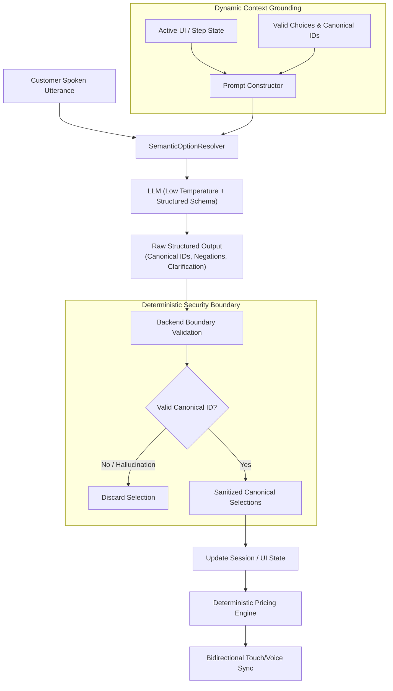

# LLM-Driven Semantic Option Resolution

## Core Philosophy: The Golden Rule

> **"Never solve natural-language understanding by continuously adding words, synonyms, phrases, aliases, or expressions to dictionaries. Send the user's actual utterance to the LLM, provide the available UI options and conversational context, and let the LLM understand the customer's meaning and select the appropriate available option."**

Human natural language has infinite entropy. Users express choices using slang, negations, colloquialisms, brand names, misnomers, multi-clause preferences, and conversational corrections (e.g., *"not too sweet"*, *"skinny"*, *"give me a bigger one"*, *"actually never mind oat, make it whole milk"*). 

Attempting to resolve choices via dictionaries, synonym maps, regex patterns, or string similarity creates brittle, unmaintainable software that degrades with every edge case.

Instead, the **LLM Semantic Option Resolver** treats the language model as a pure **semantic interpreter**:
1. Dynamically injects the valid, currently selectable options from the UI into the LLM context.
2. Prompts the LLM with structured output constraints (Pydantic / JSON schema).
3. Receives canonical option IDs chosen by the LLM based on semantic intent.
4. Strictly validates all returned IDs against the backend ground truth at the system boundary.
5. Executes all pricing, inventory checks, tax calculations, and database mutations deterministically in backend code.

---

## The 7 Non-Negotiable Prohibitions

When implementing semantic option resolution, agents and engineers must adhere strictly to these 7 invariants:

1. **PROHIBITION 1: Never maintain synonym, phrase, or alias dictionaries.**
   Do not create maps like `{"big": "large", "venti": "large", "skinny": "skim"}`. The LLM understands synonyms naturally; hardcoded maps defeat the purpose of semantic resolution.
2. **PROHIBITION 2: Never use regex or pattern matching to interpret natural-language choices.**
   Do not write regular expressions (e.g., `re.search(r'\b(oat|almond)\b')`) to extract choices. Language is contextual; regex fails on negations (*"anything but oat"*) and corrections (*"swapped oat for soy"*).
3. **PROHIBITION 3: Never let the LLM calculate prices, discounts, taxes, or totals.**
   The LLM must never perform arithmetic. Price rules, modifiers, subtotals, and currency calculations are strictly deterministic backend responsibilities.
4. **PROHIBITION 4: Never let the LLM invent or output options not present in the provided list.**
   The LLM must only output canonical IDs present in the provided choices. Any hallucinated ID must be discarded at the backend boundary.
5. **PROHIBITION 5: Never bypass backend boundary validation.**
   Never trust the LLM output directly into application state or databases. Always validate `step_id` and `option_id` against the active catalog before committing state.
6. **PROHIBITION 6: Never execute transactional mutations inside the option resolver.**
   The resolver's single responsibility is semantic interpretation. It must not charge cards, deduct inventory, or complete orders directly.
7. **PROHIBITION 7: Never invent a parallel data model or state machine.**
   Always bind directly to the existing project UI state, product catalog, and session store. Do not introduce a second, divergent data format for voice vs touch.

---

## Architecture Overview



---

## 1. When to Use LLM Semantic Option Resolution vs Alternatives

| Interaction Type | Recommended Approach | Reason |
| :--- | :--- | :--- |
| **Selecting options from open natural language** (*"give me something strong"*, *"hold the foam"*, *"window seat if possible"*) | **LLM Semantic Option Resolver** | Open vocabulary, colloquialisms, idioms, and negation cannot be modeled with finite rules. |
| **Multi-option conversational turns** (*"make it large, sugar-free, and extra hot"*) | **LLM Semantic Option Resolver** | Requires multi-intent slot filling across multiple customization steps in a single utterance. |
| **Exact machine identifiers** (*barcode scan, NFC tap, URL slug, UUID*) | Simple string comparison / dictionary lookup | Exact deterministic values with zero linguistic entropy. |
| **Free-form open text** (*customer notes, medical narrative, review text*) | Raw text capture / summarization tool | Not mapping to a finite set of UI options; requires storing open strings. |

---

## 2. Inspecting the Existing Project Architecture

Before writing any resolver code:
1. **Inspect existing LLM clients and model adapters**: Search for existing LangChain, LiteLLM, OpenAI, Anthropic, or Gemini client initializations in the repository. Do not instantiate conflicting client packages.
2. **Inspect the existing product/service catalog schema**: Identify how steps, options, default choices, and prices are structured.
3. **Inspect the session and state manager**: Locate the authoritative session state, active step index, and selection dictionaries.
4. **Locate UI touch synchronization channels**: Identify WebSockets, Server-Sent Events (SSE), or REST endpoints that update the frontend UI.

---

## 3. Reusing Existing Model Adapters & Client Patterns

Never hardcode an isolated LLM client when the repository already has configured model bindings. Follow the project's standard wrapper pattern.

If using LangChain or similar libraries that support `with_structured_output`, ensure fallback handling exists for models or providers that lack native tool-calling:

```python
from pydantic import BaseModel, Field
from typing import List, Optional

class OptionSelection(BaseModel):
    step_id: str = Field(description="The unique identifier of the customization step")
    option_id: str = Field(description="The exact canonical ID of the chosen option")
    confidence: float = Field(default=1.0, description="Confidence score between 0.0 and 1.0")

class SemanticResolutionDecision(BaseModel):
    selections: List[OptionSelection] = Field(default_factory=list)
    action: str = Field(default="select", description="'select', 'clarify', 'confirm', or 'unknown'")
    clarification_message: Optional[str] = Field(None, description="Targeted question if ambiguous or unsupported")
    reasoning: Optional[str] = Field(None, description="Brief explanation of the semantic mapping")
```

---

## 4. Dynamic UI Option Injection (Prompt Grounding)

The prompt must dynamically present **only the options valid for the current product and context**. Never hardcode option strings in the system prompt.

### Grounding Format
Present choices clearly formatted with:
- Step name and `step_id`
- Option `id`, display label, description, and price delta

```text
Current Available Customization Steps and Options:
- Step: "Size" (step_id: "size")
  Choices:
    * id: "regular", label: "Regular", price: "+$0.00"
    * id: "large", label: "Large", price: "+$0.50"
- Step: "Milk Choice" (step_id: "milk")
  Choices:
    * id: "whole", label: "Whole Milk", price: "+$0.00"
    * id: "oat", label: "Oat Milk (Plant-based)", price: "+$0.75"
    * id: "almond", label: "Almond Milk (Nut-based)", price: "+$0.75"
```

### Dynamic Grounding Rules
- Set LLM temperature low ($\le 0.1$) for deterministic extraction.
- Instruct the model: *"You must ONLY return exact option_id values from the provided choices. Do not invent options."*
- Provide the active step so the model prioritizes answers relevant to the current question, while still allowing multi-step answers.

---

## 5. Structured Decision Schemas

The structured output must capture:
1. **`selections`**: A list of `(step_id, option_id)` tuples. Allows single-turn multi-selection.
2. **`action`**:
   - `select`: One or more options successfully matched.
   - `clarify`: Utterance was ambiguous or requested an unsupported option.
   - `confirm`: User affirmed/confirmed the final summary.
   - `unknown`: Utterance is unrelated to options or chit-chat.
3. **`clarification_message`**: A concise, friendly, spoken clarification question generated by the LLM when `action == "clarify"`.

---

## 6. Multi-Selection Turns

Customers frequently answer multiple questions in a single breath:
> *"I'll take a large with oat milk and extra sugar."*

The resolver must:
1. Evaluate the utterance against **all** remaining or available steps for the product.
2. Return multiple `OptionSelection` items in `selections`:
   ```json
   [
     {"step_id": "size", "option_id": "large"},
     {"step_id": "milk", "option_id": "oat"},
     {"step_id": "sweetener", "option_id": "extra_sugar"}
   ]
   ```
3. Update all matched steps in the session state.
4. Advance the UI sequentially to the first remaining uncompleted step, or directly to review if all steps are satisfied.

---

## 7. Handling Negation, Corrections, and Conversational Shifts

### Negation Handling
Natural language negations must be interpreted correctly:
- *"No sugar"* $\implies$ `option_id: "none"` or `option_id: "zero_sugar"`
- *"I can't have dairy"* $\implies$ selects plant-based milk (`option_id: "oat"` or `option_id: "almond"`), NOT dairy.
- *"Without ice"* $\implies$ `option_id: "no_ice"`.

### Conversational Corrections
When a customer changes their mind:
- *"Actually, make that whole milk instead"*
- *"Wait, change the size to small"*

The prompt instructs the model:
> *"If the user states a correction or change of mind, prioritize their latest preference and emit the corresponding option_id."*

The backend overwrites the previous selection for that `step_id` with the newly resolved `option_id`.

---

## 8. Targeted Clarification & Unsupported Options Handling

When user requests cannot be mapped with confidence ($\ge 0.7$) or request options outside the catalog:
1. **Ambiguous requests**: *"Make it lighter"* (Could mean less syrup, lighter roast, or skim milk).
   - `action`: `"clarify"`
   - `clarification_message`: *"Would you like skim milk or less sweetener?"*
2. **Unsupported options**: *"Can I get hazelnut syrup?"* (When hazelnut is not in the catalog).
   - `action`: `"clarify"`
   - `clarification_message`: *"We don't offer hazelnut syrup, but we have vanilla and caramel. Would either of those work?"*

---

## 9. Strict Backend Boundary Validation & Hallucination Sanitization

**Never trust LLM output directly.** Always pass LLM decisions through a sanitization gate before applying them:

```python
def validate_and_sanitize(decision: SemanticResolutionDecision, valid_catalog_steps: dict) -> list[tuple[str, str]]:
    sanitized = []
    for sel in decision.selections:
        step_id = sel.step_id
        option_id = sel.option_id
        
        # 1. Step existence check
        if step_id not in valid_catalog_steps:
            logger.warning(f"Discarding invalid step_id: {step_id}")
            continue
            
        # 2. Option existence check
        valid_options = valid_catalog_steps[step_id]["options"]
        if option_id not in valid_options:
            logger.warning(f"Discarding hallucinated option_id: {option_id} for step {step_id}")
            continue
            
        sanitized.append((step_id, option_id))
    return sanitized
```

---

## 10. Deterministic Business Logic & Pricing Separation

### The Bookkeeper Invariant
> **The LLM is an interpreter, NEVER a bookkeeper, cashier, or inventory manager.**

- The LLM outputs `option_id: "large"`.
- The backend pricing function calculates:
  $$\text{New Price} = \text{Base Price} + \Delta\text{Price}(\text{large}) + \Delta\text{Price}(\text{oat})$$
- Taxes, surcharges, loyalty points, and discounts are computed 100% deterministically in Python/backend code.
- If the spoken assistant needs to state the price change, the backend generates the phrase:
  *"Large size adds \$0.50, making it \$4.50. Which milk would you prefer?"*

---

## 11. Bidirectional Touch & Voice UI Synchronization

The kiosk or application must provide parity between touch actions and voice commands:
1. **Voice-to-Touch**: When voice resolves `option_id: "large"`, the backend emits a WebSocket event `{"action": "SET_OPTION", "step": "size", "value": "large"}`. The frontend highlights the "Large" card and advances the active tab.
2. **Touch-to-Voice**: When the customer taps "Oat Milk" on screen, the frontend posts `{"step": "milk", "value": "oat"}` to the backend. The conversational context immediately reflects this selection without re-asking.

---

## 12. Error Handling, Fallbacks, Timeouts, and Graceful Degradation

If the LLM call times out (e.g., > 3.0 seconds), network drops, or JSON validation fails:
1. **Do not crash or stall the user**: Catch the exception gracefully.
2. **Preserve existing state**: Keep all previously confirmed selections intact.
3. **Graceful response**: Return a friendly conversational fallback:
   *"I'm sorry, I didn't quite catch that. Could you please repeat your choice or select it on screen?"*

---

## 13. Comprehensive Testing Strategies

### 1. Mocked Unit Tests (Fast, Deterministic)
Test every linguistic variation with mocked LLM responses:
- Direct canonical selection (*"Large"*)
- Indirect colloquialisms (*"Not a sweet tooth"*)
- Negation (*"No sugar, hold the whip"*)
- Multi-step selections (*"Large, oat milk, double shot"*)
- Boundary rejection (LLM returns `"hazelnut"` $\implies$ backend discards)
- Model timeout fallback

### 2. Live LLM Integration Tests
Test real LLM comprehension end-to-end:
- Verify model extracts valid canonical IDs for complex conversational sentences.
- Measure latency (< 800ms ideal for voice assistants).

---

## 14. Anti-Patterns & What Never To Do

| Anti-Pattern | Why It Fails | Correct Pattern |
| :--- | :--- | :--- |
| **Alias dictionaries** (`{"skinny": "skim"}`) | Fails on infinite variations, typos, and negations | Inject options into LLM prompt; let LLM infer semantics |
| **Regex matching** (`re.search(r"oat")`) | Matches negation: *"I hate oat milk, give me soy"* | LLM structured extraction captures intent and negation |
| **LLM pricing calculations** | LLMs hallucinate math, currency, and rounding | Compute prices deterministically in backend pricing engine |
| **Hardcoding options in prompt string** | Prompts go out of date when catalog updates | Dynamically serialize options from database/catalog |
| **Blindly trusting LLM output** | LLM can hallucinate non-existent IDs | Validate all returned IDs against active option list |

---

## 15. Cross-Domain Reference Examples

### Example A: Food & Beverage (Drink Customization)
- **Utterance**: *"I want a big iced latte with almond milk and just a tiny bit of sweetener."*
- **Dynamic Context**: Size (`regular`, `large`), Milk (`whole`, `oat`, `almond`), Sweetener (`none`, `less_sugar`, `regular_sugar`).
- **Resolved Output**:
  ```json
  [
    {"step_id": "size", "option_id": "large"},
    {"step_id": "milk", "option_id": "almond"},
    {"step_id": "sweetener", "option_id": "less_sugar"}
  ]
  ```

### Example B: Travel & Flight Booking (Cabin & Seat Selection)
- **Utterance**: *"I'd like extra legroom near the front, but definitely not in the middle seat."*
- **Dynamic Context**: Cabin (`economy`, `premium_economy`, `business`), Seat Preference (`aisle`, `window`, `middle`), Row (`front`, `exit_row`, `standard`).
- **Resolved Output**:
  ```json
  [
    {"step_id": "cabin", "option_id": "premium_economy"},
    {"step_id": "seat_preference", "option_id": "aisle"},
    {"step_id": "row_preference", "option_id": "front"}
  ]
  ```

### Example C: Healthcare Triage (Symptom Assessment)
- **Utterance**: *"It's been hurting pretty bad since yesterday morning, maybe like an 8 out of 10."*
- **Dynamic Context**: Severity (`mild_1_3`, `moderate_4_6`, `severe_7_10`), Duration (`acute_under_24h`, `recent_1_3_days`, `chronic_weeks`).
- **Resolved Output**:
  ```json
  [
    {"step_id": "severity", "option_id": "severe_7_10"},
    {"step_id": "duration", "option_id": "recent_1_3_days"}
  ]
  ```

### Example D: Appointment Scheduling (Salon / Wellness)
- **Utterance**: *"I just need a quick trim with whoever is available first this afternoon."*
- **Dynamic Context**: Service (`wash_and_cut`, `trim_only`, `full_color`), Stylist (`any_available`, `senior_stylist`, `master_stylist`), Time Slot (`morning`, `afternoon`, `evening`).
- **Resolved Output**:
  ```json
  [
    {"step_id": "service", "option_id": "trim_only"},
    {"step_id": "stylist", "option_id": "any_available"},
    {"step_id": "time_window", "option_id": "afternoon"}
  ]
  ```

### Example E: Retail & Hardware Configurator (Laptop Specs)
- **Utterance**: *"I do heavy 4K video editing, so max out the memory and give me the fastest chip."*
- **Dynamic Context**: Processor (`m_base`, `m_pro`, `m_max`), RAM (`16gb`, `32gb`, `64gb`, `128gb`), Storage (`512gb`, `1tb`, `2tb`, `4tb`).
- **Resolved Output**:
  ```json
  [
    {"step_id": "processor", "option_id": "m_max"},
    {"step_id": "ram", "option_id": "128gb"}
  ]
  ```

